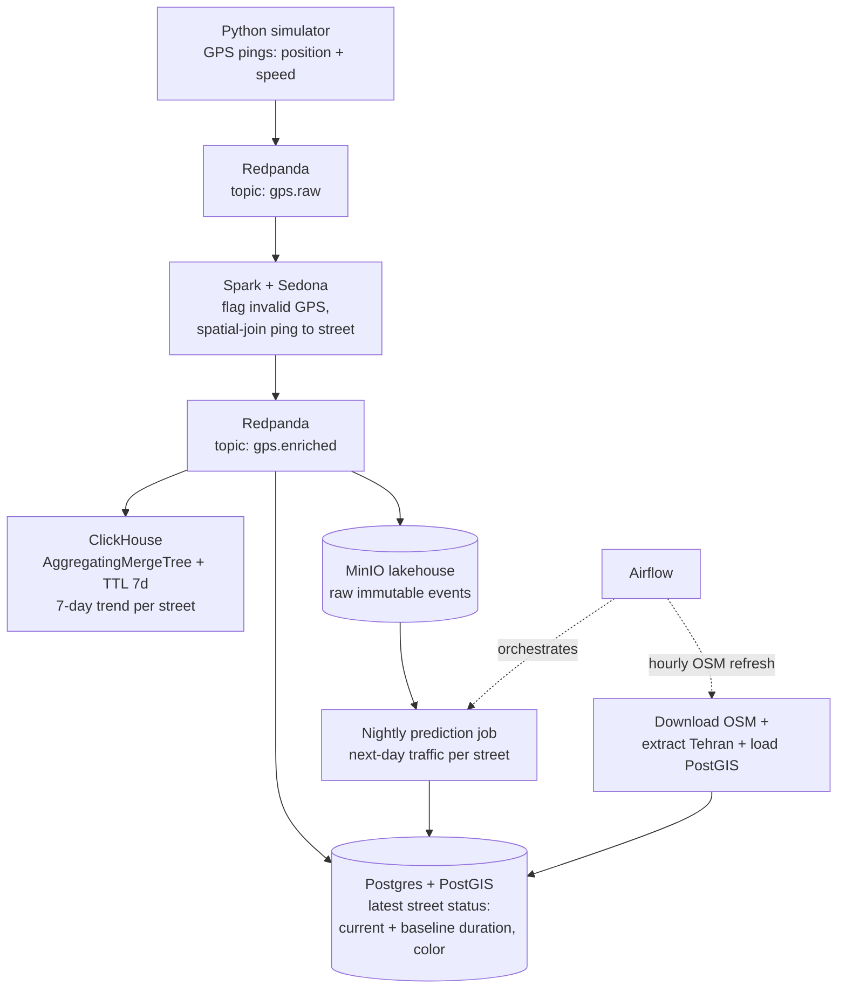
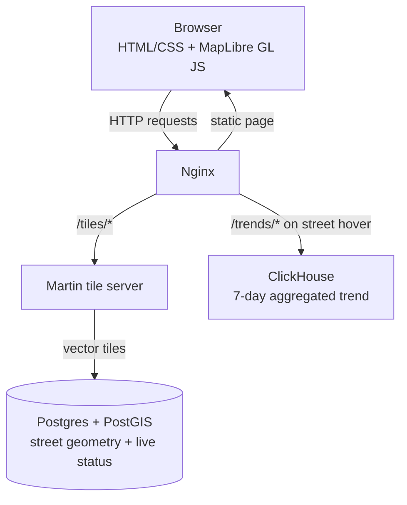
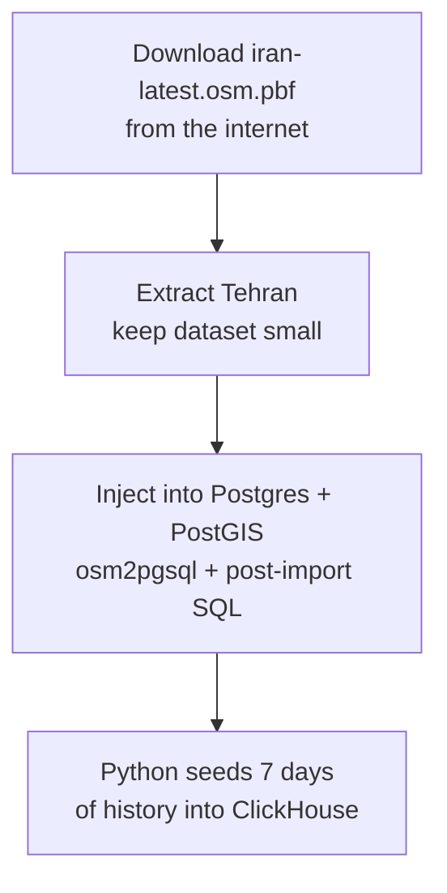

# Final project of the Data Engineering course — Real-Time Traffic Map

A minimal "Google Maps" clone for Tehran: live street-level traffic colors on a vector map, with a 7-day trend per street on hover. Built as the final project of the data engineering course. 

## Data Engineering Stack

| Component              | Role                                                                                                                                                         |
| ---------------------- | ------------------------------------------------------------------------------------------------------------------------------------------------------------ |
| **Postgres + PostGIS** | Street geometry + **latest status** of each street: current duration, current baseline duration, current color on the map.                                   |
| **Redpanda**           | Real-time data broker (`gps.raw` and `gps.enriched` topics).                                                                                                 |
| **Spark + Sedona**     | Streaming job: flags inaccurate/invalid GPS pings, spatial-joins each valid ping to a street, publishes enriched events back to Redpanda.                    |
| **ClickHouse**         | Aggregated 7-day trend per street (shown on hover). `AggregatingMergeTree` auto-aggregates, TTL keeps only 7 days of data. Receives live data from Redpanda. |
| **MinIO (lakehouse)**  | Raw immutable events; input for the nightly next-day traffic prediction job.                                                                                 |
| **Airflow**            | Orchestrates the hourly OSM refresh (download latest Iran extract → extract Tehran → load PostGIS) and the nightly prediction jobs.                          |
| **Python**             | (1) Generates the live GPS stream (coordinates + speed of users). (2) Seeds 7 days of history into ClickHouse at initialization.                             |

### Data flow

## UI Stack

- **Nginx** — serves the static page and proxies tile/trend requests.
- **HTML/CSS + MapLibre GL JS** — renders the map and live traffic colors.
- **Martin** — tile server generating vector tiles straight from PostGIS.

### Serving process

## Initialization

1. Download Iran's raw OpenStreetMap data from the internet (Geofabrik `iran-latest.osm.pbf`).
2. Extract Tehran's raw data so the dataset doesn't get exceedingly large for a final project.
3. Inject Tehran's raw data into Postgres + PostGIS (`osm2pgsql` + post-import SQL for traffic columns and indexes).
4. Seed 7 days of history into ClickHouse (Python).

