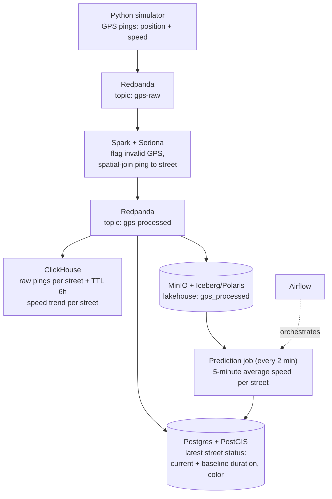

## GeoStream Maps — A real-time data-driven platform for traffic monitoring

A simulator of map and real-time traffic services (similar to Google Maps) displaying live street traffic conditions on a map. Built as the final project of the data engineering course in Sepahram School of Data Engineering. 

### Data Engineering Stack

| Component   | Role  |
| ----------- | ------ |
| **Postgres + PostGIS** | Operational database. Stores geometry, current speed, current predicted speed, current color on the map for each street. |
| **Redpanda** | Real-time data broker. |
| **Spark + Sedona** | Stream processing: map GPS pings to streets, flag inaccurate ones, and publishes enriched events back to Redpanda. |
| **ClickHouse** | Analytical database. Recent speed history per street (shown on click). Receives live data directly from Redpanda. |
| **Lakehouse (MinIO + Polaris + Iceberg)** | Storage for immutable events. Serves the job for forcasting the baseline speed for each street. |
| **Airflow** | Orchestrates the job for forcasting the baseline speed for each street. |
| **Apache Superset** | Business Intelligence dashboards. |
| **Python** | Generates the live GPS stream (coordinates + speed of users); runs as the compose service `generator`. |

### Web interfaces

| Interface            | Local URL                     |
| --------------------- | ----------------------------- |
| Map                  | [http://localhost:8080](http://localhost:8080) |
| Redpanda Console     | [http://localhost:9300](http://localhost:9300) |
| Airflow              | [http://localhost:8081](http://localhost:8081) |
| Superset | [http://localhost:8088](http://localhost:8088) |

### Data flow



### UI Stack

- **Nginx** — serves the static page and proxies tile/history requests.
- **HTML/CSS + MapLibre GL JS** — renders the map and live traffic colors.
- **Martin** — tile server generating vector tiles straight from PostGIS.


### Initialization

```bash
docker compose --profile import run --rm download-and-trim-map;
docker compose up -d postgres-1;
docker compose --profile import run --rm import-map-to-postgres;
docker compose --profile import run --rm --no-deps create-postgres-columns;
docker compose up -d;
docker compose wait minio-init polaris-init airflow-db-init;
docker compose rm -f minio-init polaris-init airflow-db-init;
```