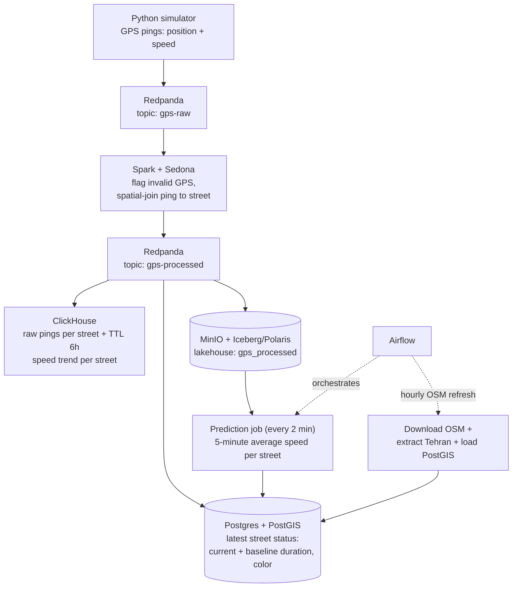
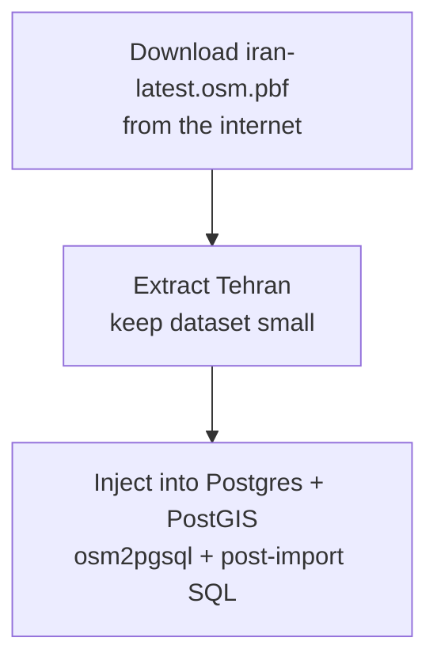

# GeoStream Maps — Final project of the Data Engineering course at Sepahram

A minimal "Google Maps" clone for Tehran: live street-level traffic colors on a vector map, with a recent speed trend per street on click. Built as the final project of the data engineering course. 

## Data Engineering Stack

| Component              | Role                                                                                                                                                                                                                                           |
| ---------------------- | ---------------------------------------------------------------------------------------------------------------------------------------------------------------------------------------------------------------------------------------------- |
| **Postgres + PostGIS** | Street geometry + **latest status** of each street: current duration, current baseline duration, current color on the map.                                                                                                                     |
| **Redpanda**           | Real-time data broker (`gps-raw` and `gps-processed` topics).                                                                                                                                                                                  |
| **Spark + Sedona**     | Streaming job: flags inaccurate/invalid GPS pings, spatial-joins each valid ping to a street, publishes enriched events back to Redpanda.                                                                                                      |
| **ClickHouse**         | Recent speed history per street (shown on click). Kafka engine table + materialized view land each enriched ping; TTL keeps only 6 hours of data. Receives live data from Redpanda.                                                            |
| **MinIO (lakehouse)**  | Raw immutable events: every `gps-processed` ping landed in the Iceberg table `polaris.telemetry.gps_processed` (partitioned `date`/`hour`), managed by the Polaris REST catalog, data files on MinIO. Input for rolling street-speed averages. |
| **Airflow**            | Airflow 3 service with LocalExecutor at `http://localhost:8081`; its `street_speed_prediction` DAG refreshes each street's five-minute average speed every two minutes.                                                                        |
| **Apache Superset**    | Optional analytics UI at `http://localhost:8088`, with persistent metadata in Postgres and a provisioned traffic-operations dashboard.                                                                                                         |
| **Python**             | Generates the live GPS stream (coordinates + speed of users); runs as the compose service `generator` (TZ=Asia/Tehran so payload timestamps are Tehran-local).                                                                                 |

### Data flow



> The prediction DAG recalculates the average speed from valid pings in the
> preceding five minutes every two minutes, keeping the lakehouse → prediction
> → Postgres loop visible during a demo.

## UI Stack

- **Nginx** — serves the static page and proxies tile/history requests.
- **HTML/CSS + MapLibre GL JS** — renders the map and live traffic colors.
- **Martin** — tile server generating vector tiles straight from PostGIS.

### Apache Superset

Set `SUPERSET_SECRET_KEY`, `SUPERSET_ADMIN_USERNAME`, `SUPERSET_ADMIN_PASSWORD`,
`SUPERSET_ADMIN_FIRST_NAME`, `SUPERSET_ADMIN_LAST_NAME`, and
`SUPERSET_ADMIN_EMAIL` in the project root `.env` file, then start Superset with:

```bash
docker compose up -d superset
```

Open `http://localhost:8088` and sign in using the configured admin username
and password. The `Tehran Traffic Operations` dashboard is imported at startup.
Superset registers only a `ClickHouse` data source; its metadata uses the
configured SQLite database. ClickHouse credentials come from the root `.env`
and are not stored in dashboard assets.

The dashboard shows recent ping volume and average speed from ClickHouse. Its
charts require active processed pings and the ClickHouse history tables to be
available.

### Serving process


## Initialization

### 1. Download and trim map data

Download Iran's raw OpenStreetMap data into `./postgres/raw-map-data/` and extract Tehran using the one-shot Compose service (automatically creates `./postgres/raw-map-data`, downloads `iran-latest.osm.pbf`, and extracts `tehran.osm.pbf`):

```bash
docker compose --profile import run --rm download-and-trim-map
```

*(Alternatively, if performing manually on host):*

```bash
wget -P ./postgres/raw-map-data https://download.geofabrik.de/asia/iran-latest.osm.pbf

osmium extract \
  --bbox 51.05,35.50,51.65,35.95 \
  --strategy complete_ways \
  ./postgres/raw-map-data/iran-latest.osm.pbf \
  --output ./postgres/raw-map-data/tehran.osm.pbf
```

### 2. Inject into Postgres and initialize stack

Run the following code to inject Tehran's raw data into Postgres + PostGIS (via `osm2pgsql` ) and create columns and indexes for live traffic). 

```bash
docker compose --profile import run --rm download-and-trim-map;
docker compose up -d postgres-1;
docker compose --profile import run --rm import-map-to-postgres;
docker compose --profile import run --rm --no-deps create-postgres-columns;
docker compose up -d;
docker compose wait minio-init polaris-init airflow-db-init;
docker compose rm -f minio-init polaris-init airflow-db-init;
```


