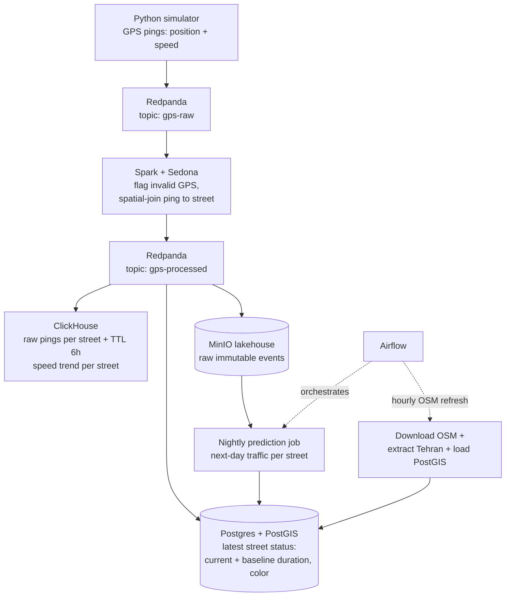
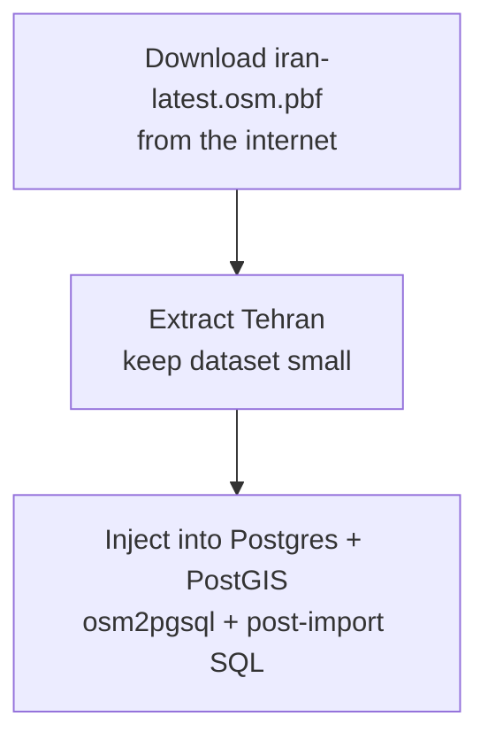

# Final project of the Data Engineering course at Sepahram — Real-Time Traffic Map

A minimal "Google Maps" clone for Tehran: live street-level traffic colors on a vector map, with a recent speed trend per street on click. Built as the final project of the data engineering course. 

## Data Engineering Stack

| Component              | Role                                                                                                                                                                                |
| ---------------------- | ----------------------------------------------------------------------------------------------------------------------------------------------------------------------------------- |
| **Postgres + PostGIS** | Street geometry + **latest status** of each street: current duration, current baseline duration, current color on the map.                                                          |
| **Redpanda**           | Real-time data broker (`gps-raw` and `gps-processed` topics).                                                                                                                       |
| **Spark + Sedona**     | Streaming job: flags inaccurate/invalid GPS pings, spatial-joins each valid ping to a street, publishes enriched events back to Redpanda.                                           |
| **ClickHouse**         | Recent speed history per street (shown on click). Kafka engine table + materialized view land each enriched ping; TTL keeps only 6 hours of data. Receives live data from Redpanda. |
| **MinIO (lakehouse)**  | Raw immutable events; input for the nightly next-day traffic prediction job.                                                                                                        |
| **Airflow**            | Orchestrates the hourly OSM refresh (download latest Iran extract → extract Tehran → load PostGIS) and the nightly prediction jobs.                                                 |
| **Python**             | Generates the live GPS stream (coordinates + speed of users).                                                                                                                       |

### Data flow



## UI Stack

- **Nginx** — serves the static page and proxies tile/history requests.
- **HTML/CSS + MapLibre GL JS** — renders the map and live traffic colors.
- **Martin** — tile server generating vector tiles straight from PostGIS.

### Serving process


## Initialization

Download a Iran's raw open streets map data into `./data/`

```bash
wget https://download.geofabrik.de/asia/iran-latest.osm.pbf
```

Extract Tehran's raw data so the dataset doesn't get exceedingly large for a final project.

```bash
osmium extract \
  --bbox 51.05,35.50,51.65,35.95 \
  --strategy complete_ways \
  iran-latest.osm.pbf \
  --output data/tehran.osm.pbf
```

Run the following code to inject Tehran's raw data into Postgres + PostGIS (via `osm2pgsql` ) and create columns and indexes for live traffic). 

```bash
docker compose up -d postgres-1; 
docker compose --profile import run --rm import-map-to-postgres; 
docker compose --profile import run --rm --no-deps create-postgres-columns; 
docker compose up -d;

```


