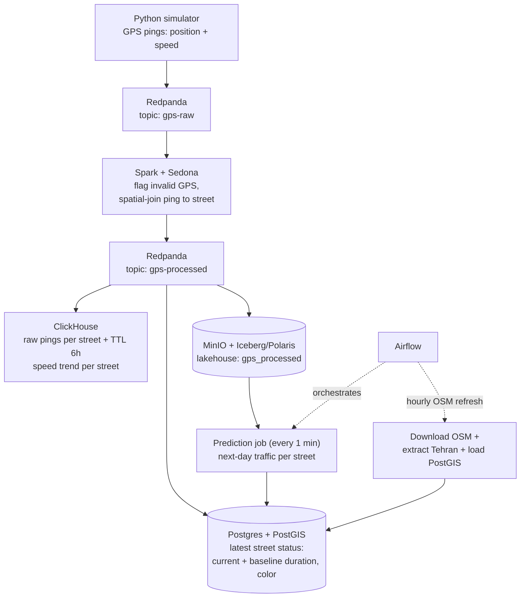
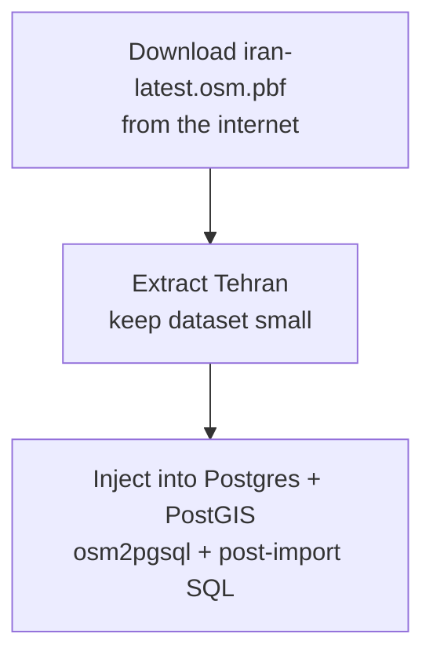

# Final project of the Data Engineering course at Sepahram — Real-Time Traffic Map

A minimal "Google Maps" clone for Tehran: live street-level traffic colors on a vector map, with a recent speed trend per street on click. Built as the final project of the data engineering course. 

## Data Engineering Stack

| Component              | Role                                                                                                                                                                                |
| ---------------------- | ----------------------------------------------------------------------------------------------------------------------------------------------------------------------------------- |
| **Postgres + PostGIS** | Street geometry + **latest status** of each street: current duration, current baseline duration, current color on the map.                                                          |
| **Redpanda**           | Real-time data broker (`gps-raw` and `gps-processed` topics).                                                                                                                       |
| **Spark + Sedona**     | Streaming job: flags inaccurate/invalid GPS pings, spatial-joins each valid ping to a street, publishes enriched events back to Redpanda.                                           |
| **ClickHouse**         | Recent speed history per street (shown on click). Kafka engine table + materialized view land each enriched ping; TTL keeps only 6 hours of data. Receives live data from Redpanda. |
| **MinIO (lakehouse)**  | Raw immutable events: every `gps-processed` ping landed in the Iceberg table `polaris.telemetry.gps_processed` (partitioned `date`/`hour`), managed by the Polaris REST catalog, data files on MinIO. Input for the next-day traffic prediction job (runs every 1 minute).                                      |
| **Airflow**            | Orchestrates the hourly OSM refresh (download latest Iran extract → extract Tehran → load PostGIS) and the prediction jobs (every 1 minute).                                         |
| **Python**             | Generates the live GPS stream (coordinates + speed of users); runs as the compose service `generator` (TZ=Asia/Tehran so payload timestamps are Tehran-local).                                                                                                                       |

### Data flow



> The prediction job runs **every 1 minute** instead of nightly: this cluster
> exists only for a course final project, and a short cadence keeps the whole
> lakehouse → prediction → Postgres loop visible during a demo.

## UI Stack

- **Nginx** — serves the static page and proxies tile/history requests.
- **HTML/CSS + MapLibre GL JS** — renders the map and live traffic colors.
- **Martin** — tile server generating vector tiles straight from PostGIS.

### Serving process


## Initialization

Download a Iran's raw open streets map data into `./data/`

```bash
wget https://download.geofabrik.de/asia/iran-latest.osm.pbf
```

Extract Tehran's raw data so the dataset doesn't get exceedingly large for a final project.

```bash
osmium extract \
  --bbox 51.05,35.50,51.65,35.95 \
  --strategy complete_ways \
  iran-latest.osm.pbf \
  --output data/tehran.osm.pbf
```

Run the following code to inject Tehran's raw data into Postgres + PostGIS (via `osm2pgsql` ) and create columns and indexes for live traffic). 

```bash
docker compose up -d postgres-1; 
docker compose --profile import run --rm import-map-to-postgres; 
docker compose --profile import run --rm --no-deps create-postgres-columns; 
docker compose up -d;

```



## Lakehouse (MinIO + Iceberg + Polaris)

A second Spark streaming job (`sedona/lakehouse_job.py`, launched alongside the
main pipeline by `sedona/start-jobs.sh` inside the `sedona-stream` container)
consumes `gps-processed` with its own consumer group (`spark-lakehouse`) and
writes every event — invalid pings and streetless pings included — into the
Iceberg table `polaris.telemetry.gps_processed`, partitioned by `date` and
`hour`. The table is managed by **Apache Polaris** (REST catalog); its Parquet
data files land in the MinIO `lakehouse` bucket under
`gps_processed/data/date=…/hour=…/`.

- Two idempotent one-shot services run on every `docker compose up -d`:
  `minio-init` creates the `lakehouse` bucket, `polaris-init` bootstraps the
  Polaris catalog (mints a token with the pinned root credentials from
  `.env`, creates the catalog with an S3 storage config pointing at MinIO,
  grants `CATALOG_MANAGE_CONTENT`). `sedona-stream` waits for both.
- Spark talks to Polaris through the Iceberg REST catalog and to MinIO through
  S3FileIO (`s3.endpoint http://minio-1:9000`, path-style, region
  `us-east-1`). All jars (Iceberg Spark runtime + AWS bundle, Kafka
  connector, Postgres JDBC, hadoop-aws + AWS SDK bundle) are downloaded at
  **build time** by `sedona/Dockerfile` — never `--packages` (runtime Maven
  downloads hang on this network). If the build host cannot reach Maven
  Central, pass a mirror:

```bash
docker compose build --build-arg MAVEN_BASE=https://<maven-mirror>/maven2 sedona-stream
```

- Inspect the landing data (creds in `.env`; or use the MinIO console at
  localhost:19001):

```bash
docker run --rm --network mahyaar-maps-mapnet minio/mc sh -c \
  'mc alias set x http://minio-1:9000 <MINIO_ROOT_USER> <MINIO_ROOT_PASSWORD> >/dev/null && \
   mc tree --files x/lakehouse/gps_processed | tail'
```

- Query the table from the `sedona-jupyter` playground (the session needs the
  same Iceberg jars + `spark.sql.catalog.polaris.*` config as
  `lakehouse_job.py`):

```python
spark.sql("SELECT * FROM polaris.telemetry.gps_processed ORDER BY timestamp DESC").show()
```
